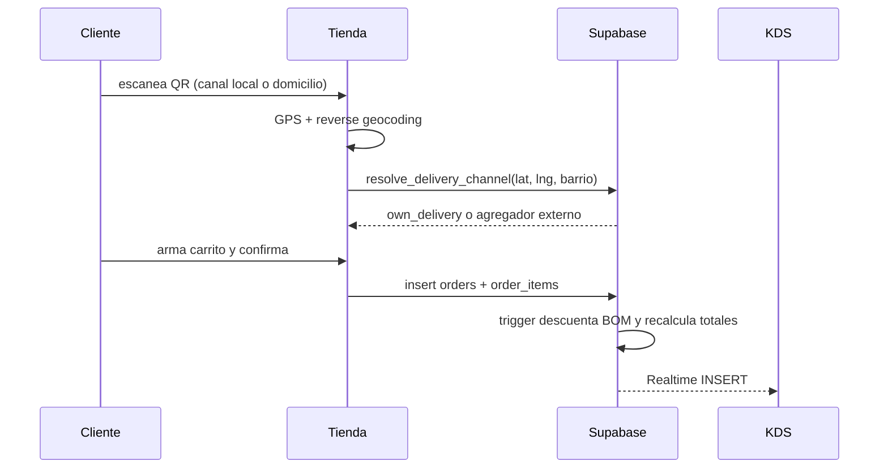

# Arquitectura · ENTUSADOS

## Principios

1. **Tienda pública en `/`.** El cliente entra directo al menú, sin login. El modo del
   pedido lo define el QR: `/?canal=local` (“Estoy Entusado”) o `/?canal=domicilio`.
2. **Back-office en `/admin`.** Login por correo (Supabase Auth en producción; demo con
   correo válido + contraseña de 4+). POS y KDS viven en `/admin/pos` y `/admin/kds`.
3. **Automatización nativa.** Triggers PostgreSQL, Realtime y Edge Functions. Sin n8n.
4. **Un módulo por dominio**, con hooks y componentes atómicos.

## Mapa de carpetas

```
src/
├── apps/
│   ├── client/          Menú, carrito, checkout, tracking
│   ├── pos/             Venta física y comandas
│   ├── kds/             Tablero de cocina
│   └── admin/           Login, dashboard, promociones, inventario, proveedores,
│                        Bre-B, caja, checklists y cobertura
├── modules/
│   ├── ordering/        Productos, promociones, carrito, creación de pedidos
│   ├── delivery/        GPS, reverse geocoding, cobertura, chat
│   ├── inventory/       Insumos, stock crítico, BOM
│   ├── suppliers/       Proveedores y órdenes de compra
│   ├── bre-b-verification/ Listener y simulador de pagos
│   ├── accounting/      Apertura/cierre de caja, gastos, utilidad
│   ├── shift-checklist/ Apertura/cierre operativo con bloqueo
│   └── pos-terminal/    Carrito rápido y tiles táctiles
└── shared/
    ├── ui/              Button, Card, Badge, Modal, Inputs, Brand, estados
    ├── services/        Supabase, auth, demo store, seed
    ├── contexts/        ClientLocationProvider (GPS compartido)
    ├── types/           DTOs y enums
    ├── lib/             Formato, cobertura, geocoding, tiempo Bogotá
    └── layouts/         ClientLayout, AdminLayout, StaffShell, AdminGuard, AccountMenu
```

## Flujos

### Pedido QR



### Cobertura de domicilio

- `delivery_zones`: barrio, alias, centro y radio.
- `resolve_delivery_channel()` primero busca coincidencia por nombre/alias y luego por
  distancia haversine; si no hay coincidencia devuelve el agregador externo.
- `fn_order_before_insert` reescribe `orders.channel` y guarda
  `delivery_zone_id`, `delivery_zone_name` y `channel_source` (`coverage`/`fallback`).
- `useDeliveryRouting(location)` replica la regla en cliente para mostrar la cobertura.

### Promociones

- `promotions` guarda los combos visibles en el carrusel.
- `Admin → Promociones` hace CRUD y define `only_at_store`.
- “Pedir ahora” agrega un combo virtual al carrito; en Supabase se inserta con
  `product_id = null` (los combos no descuentan BOM en Fase 1).

### Inventario

- `order_items` AFTER INSERT → `fn_apply_recipe_stock` → `fn_adjust_stock`.
- `fn_check_stock_alert` crea/resuelve alertas al cruzar el mínimo.
- Edición/borrado de líneas restaura o reajusta el stock.

### Pagos Bre-B

- Webhook (`supabase/functions/bre-b-webhook`) inserta en `payment_notifications`.
- El panel escucha Realtime y confirma con `fn_confirm_payment` (staff).
- Al confirmar se muestra el modal con check animado y el pedido queda pagado.

### Checklists de turno

- `shift_checklists` guarda `shift_type`, `items_checked` JSONB, notas, usuario, rol y
  timestamp.
- POS bloqueado hasta apertura al 100% (“Turno no iniciado”).
- Caja bloqueada hasta checklist de cierre al 100%.

## Routing

| Ruta | Acceso |
| --- | --- |
| `/`, `/cart`, `/checkout`, `/order/:id` | público |
| `/admin` | admin autenticado |
| `/admin/pos` | cashier o admin |
| `/admin/kds` | kitchen o admin |
| `/admin/login` | público |

`AdminGuard` muestra el login si no hay sesión staff, y redirige al home del rol si no
tiene permiso. `homeForRole`: cliente `/`, cajero `/admin/pos`, cocina `/admin/kds`,
admin `/admin`.

## Realtime

- `orders-live` → `orders`, `order_items`
- `inventory-live` → `ingredients`
- `delivery-zones-live` → `delivery_zones`, `app_settings`
- `promotions-live` → `promotions`
- `bre-b-staff` / `bre-b-<order>` → `payment_notifications`
- `chat-<order>` → `chat_messages`
- `cash-live` → `cash_closures`, `expenses`
- `shift-checklists-live` → `shift_checklists`

Cada hook usa un sufijo único de canal para evitar colisiones cuando varios componentes
se suscriben a la misma tabla.

## Variables de entorno

```
VITE_SUPABASE_URL=
VITE_SUPABASE_ANON_KEY=
VITE_STORE_LAT=4.7110
VITE_STORE_LNG=-74.0721
VITE_DELIVERY_FEE=5000
```

Con Supabase: activa **Anonymous sign-ins** para clientes sin registro, crea usuarios
staff y asigna `profiles.role`.
